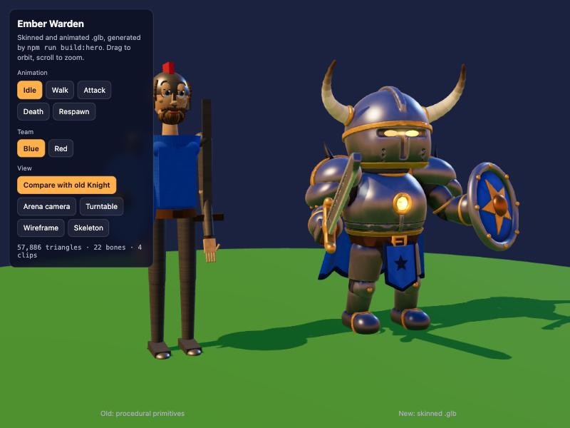
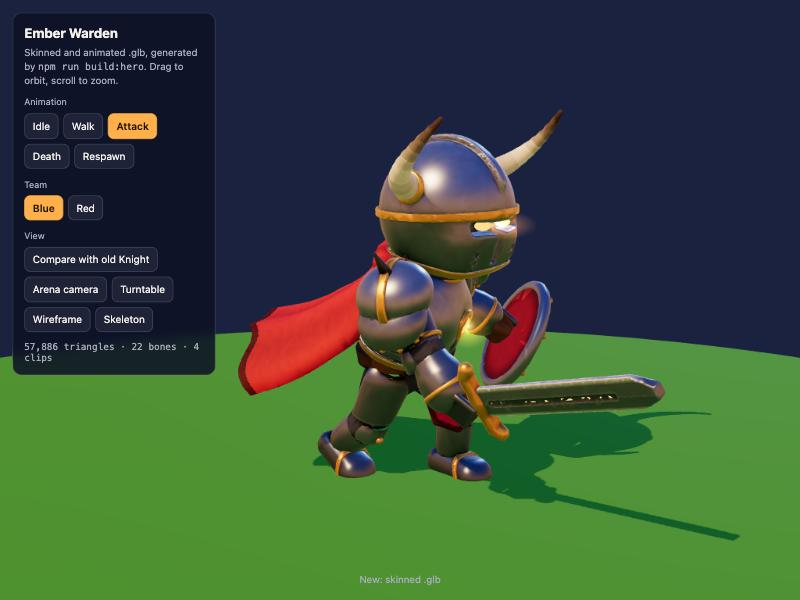

# Character pipeline: from dummy to skinned hero

The Knight card is now rendered by **the Ember Warden**, a skinned, animated
`.glb` character. This doc walks through how it's made and how to repeat it
for every other troop, whether the model comes from code, a 3D artist, an
asset store, or an AI generator.



> **New to this?** [EMBER_WARDEN_WALKTHROUGH.md](EMBER_WARDEN_WALKTHROUGH.md)
> is the step-by-step version, with a glossary, every technique explained,
> a hands-on exercise, and the problems hit along the way.

## Why the old troops looked like dummies

`src/characters.ts` builds every troop at runtime from 20–40 primitive shapes
(spheres, boxes, cylinders) and animates them by rotating hinged groups. A
primitive has no sculpted form, the joints don't bend the surface, and there's
no baked lighting detail. Tuning numbers won't fix that. The fix is a
different kind of asset.

## What a game-quality character is

| Layer | Old troops | Ember Warden |
| --- | --- | --- |
| **Shape** | Primitives glued together | Sculpted forms with smooth blends, bevels, grooves, rivets |
| **Surface** | Flat colors | Painted colors plus baked ambient occlusion, edge wear, and a top-down light gradient |
| **Deformation** | Rigid hinged groups | 22-bone skeleton; the mesh is skinned with smooth weights at elbows, knees, waist and cape |
| **Motion** | Sine waves on hinges | Authored clips (Idle, Walk, Attack, Death) with crossfades between them |
| **Lighting** | Direct lights only | An environment map shaped like the arena, so the metal reflects the golden-hour sky |
| **Format** | Code | `public/models/ember-warden.glb`, the industry-standard asset format |

The last row is the important one. Once a character is a `.glb` with a
skeleton and clips, **it doesn't matter who made it**. The game code in
`src/hero.ts` treats a generated file and an artist's file the same way.

## Files

```
tools/hero/            the "3D artist" (Node, runs offline)
  design.mjs           skeleton + every sculpted piece, palette, paint, skin weights
  animations.mjs       Idle / Walk / Attack / Death as pose functions of time
  sdf.mjs              signed-distance sculpting primitives and blend operators
  mesher.mjs           SDF -> triangles (surface nets) -> decimation (meshoptimizer)
  build.mjs            bakes AO/edge-wear into vertex colors, skins, exports .glb
public/models/ember-warden.glb   the generated asset (about 58k triangles, 2.9 MB)
src/hero.ts            runtime: load once, clone per troop, team colors, animation state
src/engine.ts          spawns a HeroInstance for Knight troops; procedural rig fallback
viewer.html            character viewer (/viewer.html in dev)
src/viewer/main.ts
```

## Try it

```bash
npm install
npm run dev
```

- `http://localhost:5173/viewer.html` is the character viewer. Use it to play
  clips, switch teams, show wireframe or the skeleton, compare against the old
  Knight, and preview the arena camera.
- `http://localhost:5173/` is the game. Deploy a Knight to see it in battle.

After editing anything in `tools/hero/`, regenerate the asset:

```bash
npm run build:hero
```

The build takes about 10 seconds and prints a per-piece triangle budget. Vite
reloads the model on the next page refresh.

## How the generator works

1. **Sculpt (`design.mjs`).** Each armor piece is a signed-distance function: a
   formula that says how far any point is from the surface. Pieces are combined
   with *smooth* unions and subtractions, which is where the sculpted, beveled
   look comes from. For example, the visor slit is a rounded box carved out of
   the helmet, and the gold bands are a thin shell of the helmet clipped to a
   slab. Every piece declares a material (`soft`, `metal`, `team`, `glow`), a
   paint function, and how it's skinned.
2. **Remesh (`mesher.mjs`).** Surface Nets turns each SDF into a dense mesh and
   snaps every vertex onto the true surface. Normals come from the SDF itself,
   so shading stays smooth after decimation.
3. **Bake (`build.mjs`).** Every vertex gets its painted color multiplied by
   ambient occlusion (traced against the whole character), cavity darkening,
   convex edge highlights, and a light-from-above gradient. This replaces a
   texture artist's AO, curvature and gradient passes.
4. **Decimate.** meshoptimizer collapses each piece by about 90%, keeping
   vertices wherever shape *or* color changes.
5. **Skin.** Armor plates are rigid on one bone (or a fixed blend, like the
   pauldrons: 55% upper arm, 45% chest). The chain-mail suit uses envelope
   weights (distance to each bone segment, softmaxed), and the cape uses
   height-based weights down its three-bone chain.
6. **Animate (`animations.mjs`).** Each clip is a function from time to pose,
   sampled at 30 fps into quaternion tracks. Key poses with easing work like an
   animator's blocking: anticipation, a fast strike, then recovery.
7. **Export.** The output is one skeleton, four skinned meshes (one per
   material), and four clips. Team color is a material named `Warden_Team`, and
   the runtime tints it.

## Swapping in a model from an artist, a store, or an AI tool

This is the path to a quality bar set by real artists. `src/hero.ts` already
handles it. The new file only has to meet this contract:

| Requirement | Why |
| --- | --- |
| glTF binary (`.glb`), Y up, facing **+Z**, feet at y = 0 | The engine places troops at ground level facing their lane |
| About 1.6–1.8 units tall | Matches tower and arena scale |
| One skeleton; clips named **Idle, Walk, Attack, Death** | `HeroInstance` looks clips up by name |
| A bone named `head` and one named `chest` | The glow sprites attach there (remove those two lines if your model has no glowing eyes or gem) |
| Team-colored parts on a material named **`Warden_Team`**, with a white or grey base | The runtime multiplies it by blue or red |
| Under about 30k triangles and about 2k px textures for a troop that appears many times | Mobile GPUs and download size |

Sources, roughly from best quality to cheapest:

- **Commission an artist.** Hand them the table above plus a turnaround sheet.
  Typical workflow: sculpt in ZBrush or Blender, retopologize, bake normal and
  AO maps, hand-paint textures, rig, animate, then export glTF from Blender
  (*File → Export → glTF 2.0*, with "+Y Up" checked and animations included).
- **Asset packs.** Stylized fantasy character packs with rigs and animations
  (Synty, KayKit, Quaternius; the last two have CC0 options). Rename the clips
  in Blender to match the contract.
- **AI 3D generators** (Meshy, Tripo, Rodin) give you a textured base mesh.
  Run it through **Mixamo** for auto-rigging and stock animations, then clean
  it up in Blender. Quality varies a lot, so review the topology.

To add a second hero, generalize `MODEL_URL` in `src/hero.ts` into a
`CardId → url` map and extend the `cardId === 'knight'` check in
`Engine.addTroop`. Everything else (clip control, team tint, death and sink,
facing) is shared.



## Performance notes

- One `.glb` is loaded once. Each troop is a `SkeletonUtils.clone`, so meshes,
  materials and geometry are shared and only the bones are per-instance.
- Materials are cloned once per team, not per troop.
- `frustumCulled = false` on the skinned meshes, because their bounds are only
  computed for the bind pose and the Death clip moves outside it.
- With about 58k triangles, even ten Wardens on screen is fine on desktop. For
  mobile, lower the vertex budget in `build.mjs` (raise `DECIMATE_ERROR`) or
  export a second, lighter LOD for the broadcast camera.

## Ideas for next steps

- Run the same treatment for the Giant and Prince: copy `design.mjs`, keep
  the skeleton, sculpt new pieces.
- Add a `Spawn` clip (drop-in from the sky) and a `Victory` clip for emotes.
- Add a bloom pass (`UnrealBloomPass`) so the ember eyes and runes glow in
  the full scene, not just through the sprite halos.
- Add normal-mapped textures for close-up cameras (Ride troop, 1st person),
  baked from the high-resolution SDF onto a UV-unwrapped low-poly mesh.
