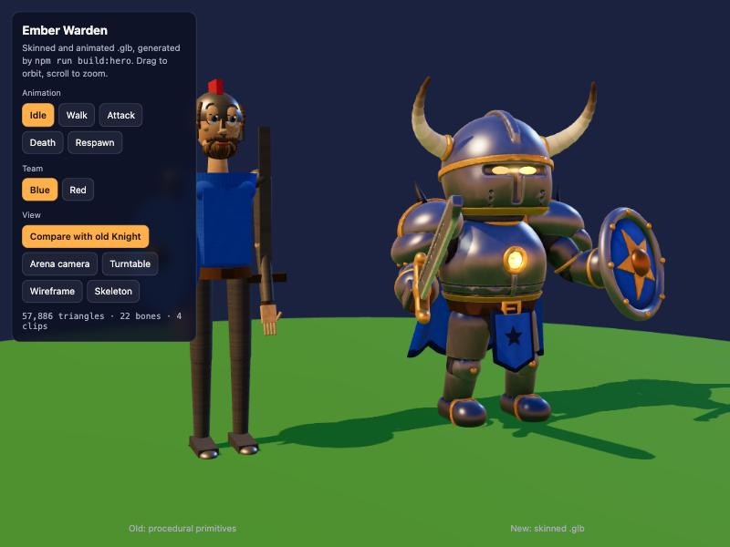
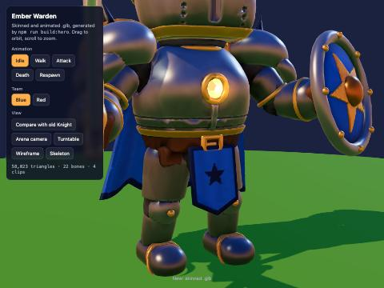

# How the Ember Warden was made: a step-by-step walkthrough

This is a complete record of how the Knight troop went from a "dummy" built
out of spheres and boxes to a skinned, animated game character. It's written
so you can follow it with **no 3D background**: every term is explained the
first time it appears, every step says what to do and how to check it, and the
mistakes made along the way are included with their fixes.



**Contents**

1. [What you get](#1-what-you-get)
2. [Quick start: run it and change something in 5 minutes](#2-quick-start-run-it-and-change-something-in-5-minutes)
3. [The ideas you need (plain-language glossary)](#3-the-ideas-you-need-plain-language-glossary)
4. [Coordinate and sign cheat sheet](#4-coordinate-and-sign-cheat-sheet)
5. [Step 1: Design brief](#step-1-design-brief)
6. [Step 2: Skeleton](#step-2-skeleton)
7. [Step 3: Body block-out](#step-3-body-block-out)
8. [Step 4: Armor, using six sculpting techniques](#step-4-armor-using-six-sculpting-techniques)
9. [Step 5: Paint](#step-5-paint)
10. [Step 6: Skin weights](#step-6-skin-weights)
11. [Step 7: Props designed for the pose (shield and sword)](#step-7-props-designed-for-the-pose-shield-and-sword)
12. [Step 8: Cape on a bone chain](#step-8-cape-on-a-bone-chain)
13. [Step 9: Build (mesh, bake, decimate, export)](#step-9-build-mesh-bake-decimate-export)
14. [Step 10: Animation clips](#step-10-animation-clips)
15. [Step 11: Load it in the game](#step-11-load-it-in-the-game)
16. [Step 12: Verify in the viewer](#step-12-verify-in-the-viewer)
17. [Hands-on exercise: add your own piece](#hands-on-exercise-add-your-own-piece)
18. [What went wrong along the way (and the fixes)](#what-went-wrong-along-the-way-and-the-fixes)
19. [Recipe: make your next character](#recipe-make-your-next-character)
20. [Troubleshooting](#troubleshooting)
21. [File map](#file-map)

---

## 1. What you get

| | |
| --- | --- |
| Asset | `public/models/ember-warden.glb` (about 2.9 MB) |
| Geometry | About 58,000 triangles in 4 meshes, one per material: soft, metal, team, glow |
| Skeleton | 22 bones (body, two hinged cloth panels: the front tabard and a 3-bone cape) |
| Animations | Idle (2.4 s loop), Walk (0.84 s loop), Attack (0.9 s), Death (1.4 s) |
| Team color | Cape, front tabard and shield face tint blue or red at runtime |
| Generated by | `npm run build:hero` (about 10 seconds, no external tools) |
| Used by | Knight troops in the game; `/viewer.html` to inspect it |

The whole character is described in two text files:
`tools/hero/design.mjs` (shape, color, skin) and
`tools/hero/animations.mjs` (motion). Everything else is machinery.

---

## 2. Quick start: run it and change something in 5 minutes

You'll make one visible change so you can see the whole loop before reading the
theory.

**1. Install and start the dev server** (from the repo root):

```bash
npm install
```

```bash
npm run dev
```

**2. Open the viewer** at <http://localhost:5173/viewer.html>. You should see
the Warden idling on a turf disc. Click **Walk**, **Attack** and **Death**.
Click **Compare with old Knight** to see the before and after.

**3. Make the horns longer.** In `tools/hero/design.mjs`, find the horn line in
the helmet section:

```js
const p0 = [s * 0.2, 1.47, -0.02], p1 = [s * 0.43, 1.5, 0.0], p2 = [s * 0.53, 1.63, 0.12], p3 = [s * 0.45, 1.81, 0.23]
```

`p3` is the horn tip. Change its height from `1.81` to `1.95`.

**4. Rebuild the model** in a second terminal:

```bash
npm run build:hero
```

The build prints a line per piece, then a summary such as
`64 pieces, 57886 triangles, 22 bones, 4 clips`.

**5. Refresh the viewer.** The horns are taller. Undo the change and rebuild
when you're done (or keep it, it's your character).

That's the entire workflow: **edit design, then build, then refresh, then look.**

---

## 3. The ideas you need (plain-language glossary)

| Term | What it means here |
| --- | --- |
| **Mesh** | The surface of a 3D object, made of triangles. The GPU only draws triangles. |
| **Skeleton / bones** | An invisible hierarchy of joints (hips, then spine, then chest, then neck, then head, and so on). Rotating a bone moves everything attached to it and to its children. |
| **Rest pose** | The pose the mesh was modeled in. Animations are stored as rotations *relative to* this pose. Here every bone's rest rotation is zero, which keeps the animation math simple. |
| **Skinning / skin weights** | Each vertex says which bones move it and how much (up to 4 bones, weights summing to 1). A vertex at the elbow that's 50% upper arm and 50% forearm bends smoothly. That smooth bending is the difference from the old "hinged dummy". |
| **Animation clip** | A named list of keyframes: for each bone, its rotation over time. "Walk" is one clip. |
| **Crossfade** | Blending from one clip to another over a fraction of a second, so switching Idle to Walk doesn't pop. |
| **glTF / .glb** | The standard file format for real-time 3D assets ("the JPEG of 3D"). `.glb` is the single-file binary version. Blender, Maya, asset stores and Three.js all speak it. |
| **SDF (signed distance function)** | A function `d(x, y, z)` that returns how far a point is from a shape's surface: negative inside, positive outside, zero on the surface. SDFs are the "clay" used to sculpt the character in code. Their superpower is **smooth blending**: two shapes can melt into each other with a fillet of any radius. |
| **Surface Nets** | The algorithm that turns an SDF into triangles: sample the SDF on a 3D grid and put a vertex wherever the sign flips. |
| **Decimation** | Reducing the triangle count while keeping the shape: flat areas need few triangles, curves need more. |
| **Vertex colors** | A color stored on each vertex and blended across triangles. Used here instead of texture images. |
| **Baking** | Precomputing lighting detail (soft contact shadows, edge highlights) into the colors, so the GPU doesn't have to compute it every frame. |
| **Ambient occlusion (AO)** | How hidden a point is from the sky. Creases and gaps are darker. Baked AO is what makes the armor look "grounded". |
| **PBR material** | Three.js `MeshStandardMaterial`: base color, plus roughness (matte to glossy), plus metalness. |
| **Environment map** | A blurred 360° picture of the surroundings, used for reflections. Without one, metal renders almost black. |
| **Emissive** | A material that glows on its own: used for the eyes, chest gem and sword runes. |

---

## 4. Coordinate and sign cheat sheet

Get these wrong and everything faces the wrong way, so they're up front.

- **Y is up, the character faces +Z**, and the feet are at `y = 0`.
- 1 unit is about the old Knight's scale. The Warden is about 1.7 units to the
  top of the helmet and about 1.8 to the horn tips.
- **The character's LEFT is +X and its RIGHT is −X.** (Facing the camera, its
  left hand is on your right.) The sword is in the right hand (−X) and the
  shield is on the left forearm (+X).
- Angles are radians: 0.5 rad ≈ 29°, 1.57 rad = 90°.

Rotation signs for animation (from the header of `animations.mjs`):

| Motion | Rotation |
| --- | --- |
| Swing a limb **forward** | negative X |
| Bend a knee (shin goes back) | positive X |
| Lean or nod **forward** | positive X |
| Turn toward the character's left | positive Y |
| Raise the **left** arm out sideways | positive Z |
| Raise the **right** arm out sideways | negative Z |
| Y rotation on a hanging limb | twists it around its own length (it doesn't swing) |

---

## Step 1: Design brief

Before touching code, decide what the character is and how it has to read.
These were the decisions, and why:

1. **Original design, not a copy.** The game borrows a famous genre, so the
   character had to be clearly its own thing: no mustache, no copied helmet.
   The concept is *"Ember Warden"*: a stout armored guardian with a horned
   bucket helm, ember-glowing eyes behind a T-shaped visor, a glowing chest
   gem, a cape, a round star shield and a rune sword.
2. **It must read from the gameplay camera**, which is about 15 units away and
   looking down. At that distance details vanish, so the character is
   designed around **silhouette** (horns, pauldrons, cape), **color blocking**
   (steel body, gold trim, team-colored cloth), and **glow focal points**
   (eyes, gem).
3. **Chunky stylized proportions.** The head (helmet) is about 35% of the
   height, the shoulders are broad, the hands and feet are oversized, and the
   legs are short. This "heroic chibi" proportion reads well small.
4. **A helmet instead of a face.** Faces are the hardest thing to make look
   good, and they're invisible at game distance anyway. A visor with glowing
   eyes gives the character personality cheaply.
5. **Budget**: under about 60k triangles, one draw call per material, and no
   textures.

> **Tip:** write your brief as 4–5 bullet points before starting the next
> character. Every later decision (where detail goes, what's team colored) comes
> from it.

---

## Step 2: Skeleton

**Goal:** define the joints first, because every piece of the character
attaches to them.

The skeleton lives at the top of `tools/hero/design.mjs`. Each bone has a
`name`, a `parent`, a rest position `pos` (in model space, not relative to the
parent), and a `tail` (where the bone "points", used only for automatic
weighting).

| Bone | Parent | Rest position | Notes |
| --- | --- | --- | --- |
| `root` | — | 0, 0, 0 | On the ground; the Death clip rotates and lifts it |
| `hips` | root | 0, 0.58, 0 | Walk bob and lunge move this |
| `spine` | hips | 0, 0.70, 0 | |
| `chest` | spine | 0, 0.86, 0 | Breastplate, pauldrons and cape attach here |
| `neck` | chest | 0, 1.07, 0 | |
| `head` | neck | 0, 1.17, 0 | Helmet, horns, eyes |
| `upperarm_L/R` | chest | ±0.33, 1.02, 0 | |
| `forearm_L/R` | upperarm | ±0.44, 0.80, 0.01 | Shield attaches to `forearm_L` |
| `hand_L/R` | forearm | ±0.50, 0.62, 0.03 | Sword attaches to `hand_R` |
| `thigh_L/R` | hips | ±0.14, 0.55, 0 | |
| `shin_L/R` | thigh | ±0.16, 0.32, 0.01 | |
| `foot_L/R` | shin | ±0.16, 0.11, 0 | |
| `tabard_F` | hips | 0, 0.63, 0.19 | Front cloth panel, hinged at the belt |
| `cape_1/2/3` | chest, then cape_1, then cape_2 | 1.02 down to 0.47 at the back | A chain, so the cape can ripple |

**Why it looks like this:**

- **The arms hang slightly outward (an "A-pose"), not straight down.** If the
  arms touch the torso in the rest pose, automatic weighting can't tell arm
  from body.
- **Left and right are generated in one loop** (`for (const [side, s] of
  [['L', 1], ['R', -1]])`), with `s` flipping X. Keep characters symmetric
  this way, and you only tune one side.
- **Bone names use underscores, never dots.** Three.js animation tracks are
  addressed as `"boneName.quaternion"`, so a bone named `upperarm.L` breaks
  that lookup silently.
- **Cloth gets its own bones** (`tabard_F`, `cape_*`). Anything that should
  move independently needs a bone.

**Check it:** in the viewer, click **Skeleton** to draw the bones over the
model.

---

## Step 3: Body block-out

**Goal:** a rough body underneath the armor. It's mostly hidden, but it fills
the gaps at elbows, knees and waist, and those parts must bend smoothly.

The building blocks come from `tools/hero/sdf.mjs`:

| Primitive | Call | Use |
| --- | --- | --- |
| Sphere | `sphere(center, r)` | Joints, rivets |
| Ellipsoid | `ellipsoid(center, [rx, ry, rz], rotation?)` | Torso, domes, pads |
| Capsule / tapered limb | `capsule(a, b, ra, rb)` | Arms, legs, horns |
| Rounded box | `roundBox(center, [hx, hy, hz], bevel, rotation?)` | Plates, buckles, blade |
| Torus (ring) | `torus(center, ringR, tubeR, rotation?)` | Trims, rings, settings |
| Cylinder | `cylinder(center, r, halfHeight, bevel, rotation?)` | Clasps, cutters |
| Star prism | `star(center, rOuter, innerRatio, halfDepth)` | Emblems |
| Curved tube | `bezierTube(p0, p1, p2, p3, r0, r1)` | Horns, rolled cloth |

Combine them with **smooth union**. The first argument is the blend radius:
`0` gives a hard seam, and `0.05` gives a 5 cm fillet.

```js
const torsoUpper = ellipsoid([0, 0.85, 0], [0.275, 0.26, 0.19])
const pelvis = ellipsoid([0, 0.6, 0], [0.185, 0.13, 0.145])
const torso = union(0.08, torsoUpper, pelvis)          // chest melts into hips
```

Then the limbs are capsules between the joint positions from Step 2, and all of
it is unioned into one piece called `undersuit`:

```js
parts.push(sphere(S, 0.09), capsule(S, E, 0.085, 0.075), capsule(E, W, 0.07, 0.06))
parts.push(capsule(Hp, K, 0.1, 0.08), capsule(K, A, 0.075, 0.065))
piece('undersuit', 'soft', union(0.05, ...parts), mailPaint, { envelope: [ ...bones ] })
```

`piece(name, material, shape, paint, skin, resolution?)` registers one part of
the character. Each piece is meshed separately, like an artist's separate armor
parts. The materials are:

| Material | Look | Used for |
| --- | --- | --- |
| `soft` | Matte, not metal | Chain mail, leather, horns, sword grip |
| `metal` | Metalness 0.9, roughness 0.33 | Steel and gold (the color tells them apart) |
| `team` | Matte cloth, tinted at runtime | Cape, tabard, shield face |
| `glow` | Emissive orange | Eyes, gem, runes |

> **Tip:** block out the whole body with plain shapes and check it in the
> viewer *before* adding any armor. Proportions are the hardest thing to fix
> later.

---

## Step 4: Armor, using six sculpting techniques

Almost every armor piece uses one or more of these six techniques. Learn them
and you can read and write all of `design.mjs`.

### Technique 1: Offset, an inflated copy of the body

`offset(shape, r)` grows a shape by `r`. The breastplate starts as the torso
inflated by 3.5 cm, so it fits the body perfectly:

```js
const plateBase = union(0.04, offset(torsoUpper, 0.035),
  ellipsoid([0.1, 0.9, 0.11], [0.14, 0.12, 0.11]), ellipsoid([-0.1, 0.9, 0.11], [0.14, 0.12, 0.11]))  // heroic pecs
```

### Technique 2: Cut with a half-space

`halfspace(point, normal)` is "everything on one side of a plane".
**Intersecting** with it chops a shape flat. The breastplate is chopped below
`y = 0.68`, and the helmet below `y = 1.13`:

```js
let plate = intersect(0.015, plateBase, halfspace([0, 0.68, 0], [0, -1, 0]))
```

The normal points *out* of the part you keep: `[0, -1, 0]` keeps what's
**above** the plane.

### Technique 3: Carve with subtract

`subtract(k, shape, cutter)` removes the cutter, leaving a rounded edge of
radius `k`. The visor is two rounded boxes carved out of the helmet:

```js
helm = subtract(0.012, helm, roundBox([0, 1.36, 0.33], [0.17, 0.026, 0.1], 0.018))  // horizontal slit
helm = subtract(0.012, helm, roundBox([0, 1.27, 0.32], [0.024, 0.075, 0.1], 0.015)) // vertical slit
```

The neck hole, arm holes, the gem socket, breathing holes and belly grooves are
all subtractions too.

### Technique 4: Band, a strip that hugs a curved surface

`band(shape, lift, thickness, planePoint, planeNormal, halfWidth)` makes a thin
shell around `shape`, clipped to a slab. It follows any curve perfectly, so
it's ideal for trims and belts:

```js
// Gold brow band around the helmet, tilted so it is higher at the front.
const brow = band(dome, 0.006, 0.009, [0, 1.36, 0], [0, 1, -0.2], 0.017)
// Leather belt that wraps the torso exactly.
band(torso, 0.02, 0.022, [0, 0.645, 0], [0, 1, 0], 0.036)
```

The same trick with `lift = 0` is used as a **cutter** to engrave grooves:

```js
for (const gy of [0.728, 0.772]) plate = subtract(0.003, plate, band(plateBase, 0, 0.005, [0, gy, 0], [0, 1, 0], 0.0035))
```

### Technique 5: Find the surface, then place details on it

To put a rivet, gem or ring *exactly on* a curved surface, march a ray at the
shape with `surfacePoint(shape, from, direction)`:

```js
const gemPos = surfacePoint(plateBase, [0, 0.91, 1], [0, 0, -1])  // start in front of the chest, march backward
piece('gem', 'glow', ellipsoid(add(gemPos, [0, 0, -0.008]), [0.045, 0.055, 0.032]), ...)
```

The helmet rivets loop around the head at several angles and call
`surfacePoint` for each one.

### Technique 6: Orient along a limb or work in a local frame

`frameY(direction)` builds a rotation whose local Y axis points along a
direction. Use it to align a ring or a box with a forearm:

```js
torus(sub(W, scale(dir, 0.022)), 0.1, 0.012, frameY(dir))   // gold cuff ring around the wrist
```

For whole props, build the object in its own local coordinates and then
`place(shape, center, rotation)` it into the world. Step 7 uses this for the
shield and sword.

### The armor list

| Piece | Main techniques |
| --- | --- |
| Breastplate | Offset, cut, carve neck and arm holes, ridge (intersect a thin box with an offset), grooves |
| Plate trim, belt | Band |
| Pauldrons (shoulders) | Two stacked rotated ellipsoids, hollowed from below, gold band stripe, rivets via `surfacePoint`, a capsule spike |
| Rerebraces, bracers | Tapered capsules along the arm, gold `torus` cuffs with `frameY` |
| Elbow and knee cops | Ellipsoids plus a small fan |
| Fists | Rounded box plus a thumb capsule, steel knuckle plate |
| Cuisses (thighs) | Offset of the thigh, cut to keep only the front |
| Greaves, sabatons | Capsule; rounded box plus toe ellipsoid cut flat at the sole |
| Helmet | Dome plus chin box (smooth union), cut, visor carve, breathing holes, crest, brow band and rim band, rivets |
| Horns | `bezierTube` tapering 6.2 cm to 1.1 cm, gold base ring |

**Check it:** rebuild and look at each piece in the viewer from several angles.
Turn on **Wireframe** to see the triangle density.

---

## Step 5: Paint

**Goal:** color that reads well, with hand-painted variation. There are no
texture images. Each piece has a paint function `(x, y, z) => [r, g, b]`
(sRGB, 0–1) that's evaluated at every vertex.

**The palette** is defined once and kept small and saturated:

```js
const C = {
  steel: hex(0x929cab), steelDark: hex(0x5d6570), iron: hex(0x3e434b), gold: hex(0xe3a93f), goldDeep: hex(0xb87a24),
  mail: hex(0x434956), coif: hex(0x535a68), leather: hex(0x6a4327), leatherDark: hex(0x3f2617),
  ivory: hex(0xeee2c6), hornTip: hex(0x4a3526), ember: hex(0xffb04a), team: hex(0xf4f4f4),
}
```

**Paint helpers:**

| Helper | Effect |
| --- | --- |
| `flat(C.gold)` | One solid color |
| `grain(C.leather, 0.2, 70)` | Color with soft noise (leather, cloth) |
| `hammered(C.steel)` | Low-frequency dents plus fine grain, for steel that doesn't look like plastic |
| `mix(a, b, t)`, `shade(c, k)`, `sstep(a, b, x)` | Blend, darken or brighten, smooth gradient |

**Patterns** are math on the position. Examples from the file:

- **Horn gradient:** ivory to dark tip using the tube's own parameter `t`,
  plus ridges from `sin(t * 60)`.
- **Tabard border and star emblem:** darker (×0.42) within 2.2 cm of the edges
  and inside a `star(...)` shape.
- **Sword edge:** brighter where the distance across the blade is above
  4.5 cm.

**Team-colored pieces are painted in greys**, not colors. The runtime
*multiplies* them by blue or red, so white means "full team color" and dark
grey means "darker team color" (trim, emblem).

> **Pitfall:** a color change only shows if there are vertices there. Small
> painted details (the tabard star) need enough mesh density. That's why the
> build is told to preserve color edges when decimating (Step 9).

---

## Step 6: Skin weights

**Goal:** decide which bones move each piece. There are three options, set by
the last argument to `piece(...)`:

**Rigid: the piece moves with one bone (or a fixed blend).** Right for any
hard object, because metal shouldn't stretch.

```js
{ rigid: { head: 1 } }                                  // helmet
{ rigid: { upperarm_L: 0.55, chest: 0.45 } }            // pauldron: follows the arm, but only partly
{ rigid: { thigh_L: 0.4, shin_L: 0.6 } }                // knee cop sits between the two
```

**Envelope: automatic weights by distance to the listed bones.** Right for
soft, continuous things like the chain-mail suit. Each vertex measures its
distance to every listed bone segment (from `pos` to `tail`), and closer bones
get exponentially more weight. The softness is the `0.028` in
`build.mjs → weights()`.

```js
{ envelope: ['hips', 'spine', 'chest', 'neck', 'upperarm_L', 'forearm_L', ...] }
```

**Function: you compute the weights.** The cape uses height to fade from
`chest`, through `cape_1` and `cape_2`, to `cape_3`:

```js
{ fn: (x, y, z) => ({ cape_1: 0.3, cape_2: 0.7 }) }      // shape of the return value
```

**`occluder`** (optional, on any of the three): explained in Step 7.

**Check it:** play **Walk** and **Attack** in the viewer and watch the elbows,
knees, waist and cape. Nothing should tear apart or bend like rubber.

---

## Step 7: Props designed for the pose (shield and sword)

**Goal:** the shield and sword should look right *in the poses you'll actually
see*, not in the rest pose.

This was the trickiest part. The rest pose has the arms hanging down, but the
idle and walk poses raise the left forearm about 84° forward to guard. A shield
modeled facing forward *in the rest pose* ends up facing the sky once the arm
is raised.

**How to solve it:** work out where "forward" will be after the pose, then
rotate backward to find the rest-pose direction. The guard pose rotates the
forearm by about −1.47 rad around X in total (shoulder −0.42 plus elbow −1.05).
Rotating the desired facing by +1.47 rad gives the rest-pose normal:

```js
// Designed for the guard pose; in the rest pose it hangs face-down under the forearm.
const n = norm([0.45, -0.875, 0.19])
```

**Build it in local coordinates.** The shield is easier to describe with its
own axes (Z out of the face), then placed:

```js
const faceDome = sphere([0, 0, -0.85], 0.88)    // a big sphere gives a gently domed face
const face = intersect(0.004, intersect(0.004, faceDome, cylinder([0, 0, 0], 0.27, 0.3, 0, toZ)),
                       halfspace([0, 0, -0.026], [0, 0, -1]))
const local = (sdf) => place(sdf, c, R)          // c = in front of the fist, R = shield axes
piece('shield_face', 'team', local(face), facePaint, { rigid: { forearm_L: 1 }, occluder: 'shield' })
```

The shield is **center-gripped**: its boss sits 11.5 cm in front of the left
fist, which is why the fist doesn't poke through the face.

**The sword** works the same way. Its rest direction is
`norm([-0.3, -0.5, 1])` (forward, down and slightly outward), so that the idle
pose's raised forearm tips it up and *away* from the face.

**`occluder: 'shield'` / `'sword'`.** Ambient occlusion is baked in the rest
pose, where the shield hangs near the thigh. Without isolation, the shield
would bake a dark shadow onto the leg that stays there even when the shield
moves away. Pieces with an `occluder` name only shadow pieces with the same
name.

**Check it:** idle in the viewer. The shield should face forward with the star
upright, and the sword should point up and outward, clear of the visor.

---

## Step 8: Cape on a bone chain

**Goal:** a big, readable silhouette from behind (the first version had a bare
back, which looked unfinished), and secondary motion that makes the character
feel alive.

The cape is a **custom SDF**: a thin shell of an elliptical cylinder that
flares toward the bottom, with sine-wave folds and a wavy hem. The key lines:

```js
const a = (0.27 + 0.2 * u) * fold, b = (0.18 + 0.1 * u) * fold   // wider and deeper further down (u = distance below the top)
const shell = Math.abs(ell) - 0.011                               // 1.1 cm thick
const hem = BOTTOM + 0.025 * Math.sin(phi * 7 + 1.2) + 0.05 * Math.abs(Math.sin(phi))
return Math.max(shell, hem - y, y - TOP, (z - cz) - 0.015)        // shell, cut to height, back half only
```

`node(fn, min, max)` wraps any function as a shape. The bounding box tells the
mesher where to sample.

Skin weights fade down the chain by height (`fn` skinning from Step 6). A rolled
"mantle" (a `bezierTube`) and two gold clasps hide where the cape meets the
shoulders.

**Check it:** walk, attack and die in the viewer from behind. The cape should
trail and swing, not snap.

---

## Step 9: Build (mesh, bake, decimate, export)

Run:

```bash
npm run build:hero
```

What `tools/hero/build.mjs` does for **each piece**:

1. **Mesh.** Surface Nets samples the SDF on a grid with a voxel size of 6.5 mm
   (`DEFAULT_RES`; some pieces override it to be finer), then snaps each
   vertex exactly onto the surface.
2. **Cull hidden triangles.** It drops any triangle completely buried inside
   another piece. The breastplate covers most of the undersuit, so that
   geometry is never drawn.
3. **Bake color per vertex:**
   - the paint color, converted to linear RGB
   - × **ambient occlusion**: 5 samples stepping out along the normal and
     checking how close other geometry is
   - × **top-down gradient**: the feet are about 20% darker than the head, a
     classic stylized-art trick
   - × **cavity darkening** and + **edge highlights**, from the surface
     curvature. Convex edges get brighter, strongest on metal, which reads as
     painted edge wear.
   - Glow pieces skip baking.
4. **Decimate** with meshoptimizer, keeping vertices where either the **shape**
   or the **baked color** changes. Raw pieces have about 1 million triangles
   in total; the output is about 58k.
5. **Normals** come from the SDF gradient, not the triangles, so shading stays
   smooth after decimation.
6. **Skin weights** are computed per vertex (Step 6).

Then all pieces are merged into **one mesh per material**, bound to the
skeleton, the clips are sampled (Step 10), and everything is exported with
Three.js's `GLTFExporter`.

**The knobs** (top of `build.mjs`):

| Constant | Value | Raise it to… | Lower it to… |
| --- | --- | --- | --- |
| `DEFAULT_RES` | 0.0065 | build faster, softer detail | capture finer detail, slower |
| `DECIMATE_ERROR` | 0.0022 | get fewer triangles (mobile) | get smoother silhouettes |
| `DECIMATE_RATIO` | 0.05 | (it's a floor; the error usually decides) | — |
| `COLOR_WEIGHT` | 0.6 | keep painted details crisper (more triangles) | get fewer triangles, blurrier paint |

**Check it:** read the build output. Every piece is listed with
`raw -> final` triangles. A line `! <piece>: completely hidden, skipped` means
that piece is entirely inside another one (see "What went wrong" below).

---

## Step 10: Animation clips

**Goal:** four clips with weight and personality. Animations are written as
**functions of time that return a pose**, then sampled at 30 fps into
keyframes. This is the same data an animator's keyed clip ends up as.

A **pose** is `{ boneName: [rx, ry, rz] }` in radians (offsets from the rest
pose), plus optional `pos: { hips: [dx, dy, dz] }` translations. Only `root`
and `hips` have position tracks.

Four helpers in `animations.mjs` do most of the work:

| Helper | What it does |
| --- | --- |
| `stance(breath)` | The shared ready pose: knees soft, sword up, shield guarding, `breath` (−1..1) for the chest rise |
| `layer(base, over)` | Adds offsets on top of a pose (for example "the stance, but the sword arm raised 2.35 rad more") |
| `blend(a, b, t)` | Interpolates two poses |
| `keyed([{ t, pose, ease? }, ...])` | Key poses at times, smoothly eased between: how animators "block" an action |

### Idle (2.4 s loop)

The stance, with breathing (`sin`), a slow head look-around, small arm sway and
cloth drift. Every motion uses `sin(phase + offset)` with a different offset,
so things don't move in lockstep.

### Walk (0.84 s loop, two steps)

Pure math on the phase `ph` (0 to 2π over the cycle):

```js
const thighL = -0.55 * s, thighR = 0.55 * s                       // legs swing opposite (s = sin(ph))
const kneeL = 0.1 + 0.85 * Math.pow(Math.max(0, c), 1.4)          // knee bends while the leg swings forward
foot_L: [-(thighL + kneeL) * 0.75, 0, -0.03]                      // keep the foot roughly flat
pos: { hips: [0, -0.03 + 0.025 * Math.cos(ph * 2), 0] }           // bob: low at each foot strike
hips: [0, 0.13 * s, 0.05 * s], chest: [-0.02, -0.12 * s, 0]       // pelvis turns, chest counter-turns
tabard_F: [Math.min(thighL, thighR) * 0.85 - 0.04, 0, 0]           // front panel pushed by the forward leg
```

The arms swing opposite to the legs, and the cape trails back with a lagging
ripple down the chain.

### Attack (0.9 s, plays once)

Classic **anticipation, strike, recovery**:

| Time | Key pose | Feel |
| --- | --- | --- |
| 0.00 | ready | |
| 0.30 | **wind-up**: twist away, lean back, sword arm overhead (−2.35 rad) | slow (smooth ease) |
| 0.38 | **strike**: twist through, lunge forward, hips drop 7 cm, cape flies back | **fast** (ease-out cubic): 80 ms |
| 0.50 | follow-through | |
| 0.90 | back to ready | |

The contrast between the slow wind-up and the fast strike is what makes it
feel powerful.

### Death (1.4 s, holds the last frame)

Knocked back (0.14 s), knees buckle (0.5 s), then it falls backward by rotating
the `root` bone about −1.42 rad around X and lifting it 22 cm so the body
rests on the ground (0.95 s, accelerating like gravity), with a small bounce
(1.08 s) before settling.

**Check it:** the viewer can freeze any frame from the URL, which is the
fastest way to tune a pose:

```
/viewer.html?clip=Attack&t=0.27&yaw=0.9
/viewer.html?clip=Walk&t=0.21&yaw=1.3
/viewer.html?clip=Death&t=1.6
```

`t` is seconds after the clip starts (Attack starts 0.12 s in, see Step 11),
and `yaw` turns the character.

---

## Step 11: Load it in the game

The runtime is `src/hero.ts`, and it works for **any** `.glb` that follows the
contract in `CHARACTER_PIPELINE.md`. Here's what each part does and why.

**1. Load once, early.** In `src/main.tsx`:

```ts
preloadHero()   // starts the download at app start; troops fall back to the old rig until it's ready
```

**2. One instance per troop with `SkeletonUtils.clone`.**

```ts
const model = SkeletonUtils.clone(asset.scene)
```

A plain `.clone()` would leave every copy driven by the *original* skeleton, so
all Knights would move together. `SkeletonUtils.clone` rebinds each copy to its
own bones. Geometry is still shared, so memory stays low.

**3. Team materials, cloned once per team, not per troop.** The material named
`Warden_Team` is tinted blue (`0x2f6df6`) or red (`0xe23b3b`).

**4. Environment map for the metal.** `makeArenaEnvironment(renderer)` renders
a tiny sky, sun and grass scene in the arena's golden-hour colors into a
blurred reflection map. Without it, `metalness 0.9` looks nearly black.

**5. The animation state machine** (`HeroInstance`):

| Call | When | What happens |
| --- | --- | --- |
| `setSpeed(v)` | Every frame | Crossfades Idle and Walk at 0.15 u/s; sets the walk playback speed to `v / 1.15` so feet don't slide |
| `attack()` | When the game lands a hit | Crossfades into Attack, **starting 0.12 s in**, so the strike lands soon after the damage |
| `die()` | When the troop is removed | Plays Death and holds the final frame |
| `update(dt, t)` | Every frame | Advances the mixer; flickers the ember glow |

**6. Engine hooks** (`src/engine.ts`):

- `addTroop`: if the card is `knight` and the model has loaded, create a
  `HeroInstance` instead of the procedural rig.
- Every frame, measure each hero's speed from its position change, turn it
  smoothly toward the direction of travel, and detect a hit: `game.ts` resets
  `attackCd` to 1 when a hit lands, so a jump in `attackCd` means "swing now".
- `removeTroop`: play Death, wait for the clip plus 1.2 s, sink into the turf
  over 1.5 s, then dispose.

**7. Glow halos.** Two additive sprites (on the `head` and `chest` bones) fake a
bloom around the eyes and gem.

**Check it:** start a battle, deploy a Knight, and watch it walk, turn, swing
and die. The browser console should be free of errors.

---

## Step 12: Verify in the viewer

`/viewer.html` (source in `src/viewer/main.ts`) uses the same lights as the
arena. Run through this checklist after every change:

- [ ] Idle, front view: helmet, eyes, gem, shield star upright, sword clear of the visor
- [ ] Back view: cape covers the back, hem dark trim visible
- [ ] Walk: no foot sliding, cape trails, tabard doesn't vanish into the legs
- [ ] Attack at `t=0.27`: lunge reads clearly, sword extended
- [ ] Death at `t=1.6`: lying on its back, mostly above the ground
- [ ] **Red** team: cape, tabard and shield face turn red
- [ ] **Arena camera**: still readable at game distance (silhouette and colors)
- [ ] **Compare with old Knight**: same overall scale
- [ ] Build output: no `completely hidden` warnings for pieces you expect to see

**URL parameters** (for reproducible screenshots): `clip`, `t` (freeze time),
`team=red`, `compare=1`, `yaw` (turn the model, disables turntable), and
`cam=x,y,z,targetX,targetY,targetZ`.

---

## Hands-on exercise: add your own piece

To try the loop end to end, add a leather belt pouch on the right hip. Paste
this into `tools/hero/design.mjs` just above the line
`// Bones that pieces may reference must exist.`:

```js
// ---- Belt pouch (tutorial example) ----
{
  const p = surfacePoint(torso, [-0.17, 0.6, 1], [0, 0, -1])   // find the hip surface (right side = -X)
  piece('pouch', 'soft', roundBox(add(p, [0, -0.01, 0.03]), [0.055, 0.05, 0.035], 0.022), grain(C.leather, 0.2, 70), { rigid: { hips: 1 } })
}
```

Run `npm run build:hero`. The output should include a line like
`pouch  2212 -> 127 tris`. Refresh
`/viewer.html?yaw=0.5&cam=0,0.9,2.3,0,0.6,0`, and the pouch hangs below the
belt next to the tabard:



Things to try next with it: give it a gold buckle (a second, `metal` piece
using `flat(C.gold)`), move it to the back, or make it swing by giving it its
own bone.

---

## What went wrong along the way (and the fixes)

The first build wasn't the final one. These are the real problems hit while
making the Warden. Expect similar ones on your own characters.

| # | Symptom | Cause | Fix |
| --- | --- | --- | --- |
| 1 | Build warned `pauldron_rivets` and `sword_runes` were **completely hidden** | Rivets were placed with a guessed position that landed inside the pauldron; the rune boxes were thinner than the groove depth, so they sat inside the blade | Place details with `surfacePoint` from the outside in; make the fuller groove deeper (floor at 1.8 cm) and the runes thicker (1.95 cm) so they sit just above the groove floor |
| 2 | First export was **186k triangles, 8 MB** | Decimation was too gentle (ratio 0.3, error 1.2 mm) | Ask for a big reduction (ratio 0.05) and let the error bound (2.2 mm) decide: 34k triangles |
| 3 | After that, the **tabard star and trims faded** | Decimation only looked at shape, so it removed the vertices that carried the paint | Bake colors *before* decimating and use attribute-aware simplification (`COLOR_WEIGHT`). That brought it back to about 47k triangles |
| 4 | Metal looked like **chrome plastic**, and the character read as a "robot" | Light, uniform, mirror-like steel | Darker steel (`0x929cab`), `hammered()` paint noise, belly grooves, upper-arm plates, a V-shaped torso |
| 5 | **Bare, boring back** | Only a small back tabard | Added the cape on a 3-bone chain plus mantle and clasps (and removed the back tabard) |
| 6 | **Shield edge-on**, sticking out sideways | Modeled facing forward in the *rest* pose; the guard pose rotated it to face outward or up | Designed for the posed state: rest-pose normal `[0.45, -0.875, 0.19]` (Step 7) |
| 7 | **Fist poking through the shield face** | That normal is nearly parallel to the forearm, so the disc sat around the fist | Made it a center-grip shield: boss 11.5 cm in front of the fist |
| 8 | **Sword blade crossing the visor** | Forearm twist (+0.15 Y) plus a straight-forward blade tipped it inward when raised | Removed the twist, angled the blade outward in the rest pose (`[-0.3, -0.5, 1]`), lowered the forearm raise (−0.85 to −0.75) |
| 9 | Shield could bake a **wrong shadow onto the thigh** | AO is baked in the rest pose, where the shield hangs by the leg | `occluder` groups: props only occlude themselves |
| 10 | Viewer `?clip=Death` showed **Idle** | `spawn()` reset the clip variable before it was read | Capture the requested clip before spawning |

**General lessons:**

- **Look at it after every change**, from the front, the back, and the game
  camera. Most of these problems were obvious in a screenshot and invisible in
  the code.
- **Design held props in the pose they're seen in.**
- **Place details on surfaces by marching onto them**, never by guessing
  coordinates.
- **The build log is a checklist**: a hidden piece is always a bug.

---

## Recipe: make your next character

Use this to turn the Giant, Prince or any other troop into a skinned character.

1. **Brief**: 4–5 bullets on silhouette, colors, glow points and proportions
   (Step 1).
2. **Copy the generator**: duplicate `tools/hero/design.mjs` and
   `animations.mjs` (for example `design-giant.mjs`), and make `build.mjs`
   take the design file and output name as arguments (or copy it too).
3. **Skeleton**: keep the same bone names if the body type is similar, so
   `animations.mjs` mostly carries over. Adjust positions for new proportions.
4. **Block out** the body with plain shapes. Check proportions in the viewer.
5. **Hard parts** with the six techniques (Step 4), one `piece` at a time.
   Rebuild often.
6. **Paint**: a palette of about 8 colors, team parts in greys.
7. **Skin**: rigid for hard things, envelope for the body, `fn` for chains.
8. **Props**: design for the pose; set `occluder`.
9. **Clips**: start from `stance()`, then do Idle, Walk, Attack, Death. Tune
   with `?clip=...&t=...`.
10. **Runtime**: turn `MODEL_URL` in `src/hero.ts` into a `CardId → url` map,
    and change the `cardId === 'knight'` check in `Engine.addTroop` to "has a
    model". Material names (`*_Team`, `*_Glow`) and the glow-sprite bones
    (`head`, `chest`) should match, or be made configurable.
11. **Verify** with the Step 12 checklist and in a real battle.

**Or skip the generator** and use an artist's model, a store asset, or an AI
model rigged in Mixamo. Follow the asset contract in
[CHARACTER_PIPELINE.md](CHARACTER_PIPELINE.md); steps 10–11 stay the same.

---

## Troubleshooting

| Problem | Likely cause | What to do |
| --- | --- | --- |
| `! piece: completely hidden, skipped` | Piece is fully inside another piece | Move it outward or place it with `surfacePoint` |
| `references unknown bone X` | Typo in a skin, or a bone you removed | Check the `BONES` names (underscores, not dots) |
| Piece is a blob or empty | Wrong sign in a `halfspace` cut, or a blend radius bigger than the part | The normal points *out of* the part you keep; reduce the `k` value |
| Piece has jagged or noisy edges | Detail smaller than the voxel size | Pass a finer resolution as the 6th `piece` argument (for example `0.004`) |
| Painted detail missing | Not enough vertices there after decimation | Raise `COLOR_WEIGHT` or lower `DECIMATE_ERROR`; give the piece a finer resolution |
| Everything faces the wrong way | Built facing −Z or with the wrong left and right | Re-read section 4: face +Z, left = +X |
| All troops move in sync | Used `.clone()` instead of `SkeletonUtils.clone` | See Step 11 |
| Metal is black | No environment map | `setHeroEnvironment(makeArenaEnvironment(renderer))` before spawning |
| Feet slide when walking | Walk playback speed doesn't match the ground speed | Tune `WALK_SPEED_AT_1X` in `src/hero.ts` |
| Character vanishes near the screen edge during Death | Frustum culling with bind-pose bounds | Keep `frustumCulled = false` on skinned meshes |
| Old model still shows after rebuilding | Browser cache | Hard-refresh the page |

---

## File map

```
tools/hero/
  design.mjs        Skeleton, palette, every piece (shape + paint + skin)       <- you edit this
  animations.mjs    Idle / Walk / Attack / Death pose functions                 <- and this
  sdf.mjs           Sculpting primitives, smooth blend operators, noise
  mesher.mjs        Surface Nets meshing + meshoptimizer decimation
  build.mjs         Bake, skin, sample clips, export .glb (knobs at the top)
public/models/ember-warden.glb   Generated asset (rebuilt by npm run build:hero)
src/hero.ts         Runtime: load, clone, team materials, env map, animation state
src/engine.ts       Spawns heroes for Knight troops; death and sink; facing
src/main.tsx        Preloads the model at startup
viewer.html, src/viewer/main.ts   Character viewer
docs/CHARACTER_PIPELINE.md        Overview + asset contract for artist-made models
```
